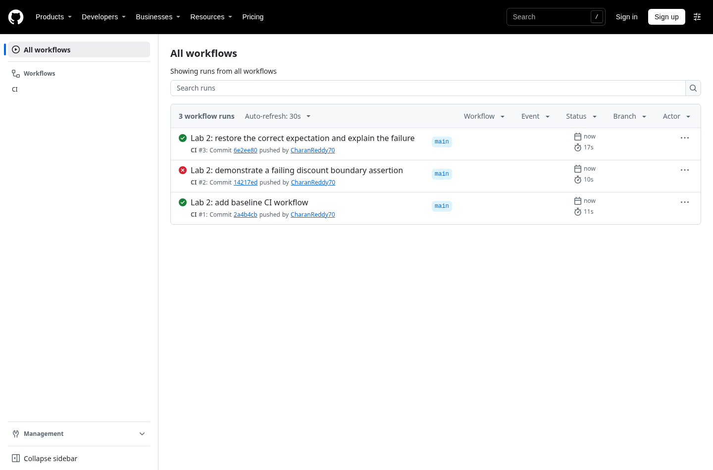
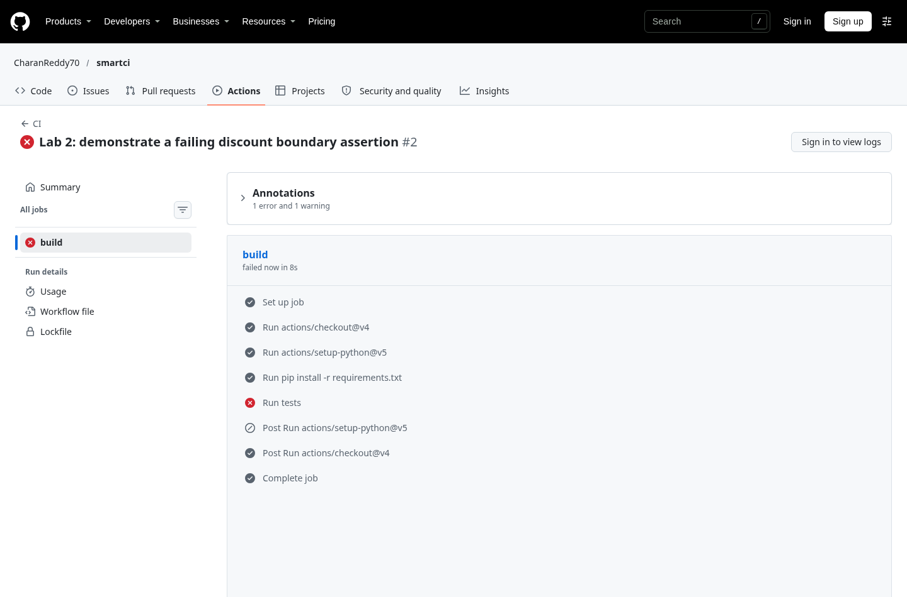
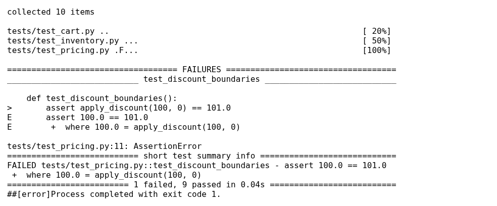

# Lab 2 — Diagnosing a red CI run

A red run flags a check that failed for a specific commit. Here the experiment changes the expected price of a 100-unit purchase with a 0% discount to 101. The price should stay at 100, so the fix is to restore the test expectation.

In GitHub Actions, open **Actions → CI**, select the failed run, open the **build** job, and expand **Run tests**. Look under **FAILURES** for `test_discount_boundaries`. The assertion output identifies the actual and expected values, and the next line identifies the file and line number.

Locally, the experiment produced `assert 100.0 == 101.0` in `tests/test_pricing.py`, with one failed test and nine passing. Restoring the expectation made all ten tests pass. The workflow uses `tee` to display and save pytest output. With `pipefail`, pytest's failure makes the step fail even when `tee` writes the log successfully.

## GitHub Actions results

| Run | Result | Total time |
| --- | --- | --- |
| [Baseline #1](https://github.com/CharanReddy70/smartci/actions/runs/45386052467) | Passed | 11 s |
| [Intentional failure #2](https://github.com/CharanReddy70/smartci/actions/runs/45386058658/job/138417138468) | 1 failed, 9 passed | 10 s |
| [Correction #3](https://github.com/CharanReddy70/smartci/actions/runs/45386063162) | 10 passed | 17 s |

The baseline dependency installation took 3 s. In run #2, pytest identified line 11 of `tests/test_pricing.py`. The job exited with code 1. Run #3 passed after the expected value was restored to 100.

